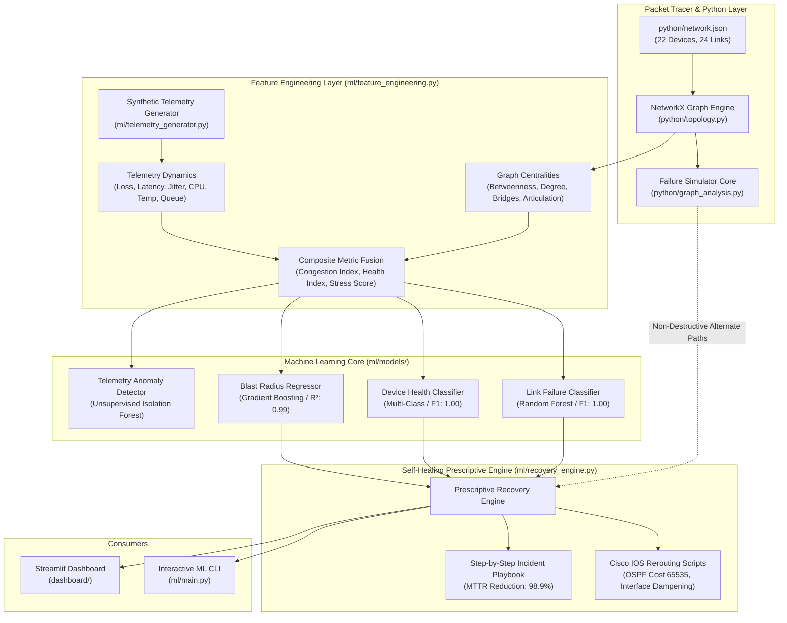

# Machine Learning Digital Twin: Predictive Failure & Self-Healing Recovery Core

**Project:** AI-Driven Network Digital Twin for Predictive Network Failure Recovery Analysis  
**Module:** Machine Learning & Prescriptive Recovery Engine (`ml/`)  
**Target Consumers:** Digital Twin Simulator & Streamlit Dashboard (`dashboard/`), Network Operations Center (NOC) CLI  
**Integration Status:** Direct import integration with `python/` topology graph and Packet Tracer schema  

---

## 1. Executive Summary & Purpose

The `ml/` module constitutes the **intelligence and self-healing layer** of the enterprise Network Digital Twin. While the `python/` module models the baseline NetworkX topological graph and `packet_tracer/` defines the physical/logical network design, the `ml/` module transforms the twin from a passive representation into an **active, predictive, and self-healing system**.

### Key Capabilities:
1. **Multi-Model Failure Prediction:** Computes real-time failure probabilities and risk classifications for all 24 links and 22 devices across the enterprise's 5 branches.
2. **Topological-Telemetry Feature Fusion:** Combines graph-theoretic invariants (edge betweenness, articulation points, bridges, path redundancy) with time-series physical telemetry (packet loss, jitter, buffer queue saturation, CPU/memory exhaustion, thermal throttling).
3. **Unsupervised Anomaly Detection:** Leverages an Isolation Forest watchdog to detect zero-day anomalies, subtle jitter drifts, and pre-failure indicators before hard threshold breaches occur.
4. **Prescriptive Self-Healing & Rerouting:** Formulates automated mitigation playbooks, evaluates bottleneck bandwidth and hop counts on alternate paths, and outputs exact Cisco IOS configuration remediation snippets.

---

## 2. System Architecture



---

## 3. Mathematical Formulation & Feature Engineering

### A. Link Congestion Index (\(I_c\))
Quantifies multi-factor transmission stress into a normalized interval \([0, 1]\):
$$I_c = 0.4 \left(\frac{U}{100}\right) + 0.3 \left(\frac{Q}{100}\right) + 0.2 \left(\frac{J}{20}\right) + 0.1 \left(\frac{L}{10}\right)$$
Where:
- \(U\): Bandwidth utilization percentage (\(\%\))
- \(Q\): Buffer queue depth percentage (\(\%\))
- \(J\): One-way packet jitter (\(\text{ms}\))
- \(L\): Packet loss rate (\(\%\))

### B. Normalized Link Health Index (\(H_{\text{link}}\))
Calculates health scoring on a scale from \(0.0\) (collapsed) to \(100.0\) (optimal):
$$H_{\text{link}} = \max\Big(0, \, 100 - \big(8.0 L + \frac{10.0 D}{30} + 2.5 J + 2.0 E + 0.8 \max(0, U - 75)\big)\Big)$$
Where \(D\) is propagation latency (\(\text{ms}\)) and \(E\) is interface CRC error count per minute.

### C. Device Multi-Dimensional Stress Score (\(S_{\text{dev}}\))
Evaluates internal hardware operating conditions:
$$S_{\text{dev}} = 0.30 \left(\frac{C}{100}\right) + 0.25 \left(\frac{M}{100}\right) + 0.20 \left(\frac{T - 30}{45}\right) + 0.15 \left(\frac{B}{100}\right) + 0.10 \left(\frac{E_{\text{if}}}{50}\right)$$
Where:
- \(C\): CPU load percentage (\(\%\))
- \(M\): RAM memory utilization percentage (\(\%\))
- \(T\): Chassis thermal temperature (\(^\circ\text{C}\))
- \(B\): Packet buffer allocation percentage (\(\%\))
- \(E_{\text{if}}\): Total interface error drop rate

---

## 4. Directory Structure

```text
ml/
├── __init__.py                 # Clean package exports
├── requirements.txt            # ML dependencies (networkx, scikit-learn, pandas, numpy, joblib, pytest)
├── config.py                   # Centralized paths, thresholds, and inventory constants
├── feature_engineering.py      # Graph-theoretic + telemetry feature extractor
├── telemetry_generator.py      # Synthetic time-series & failure injection simulation engine
├── anomaly_detector.py         # Unsupervised Isolation Forest watchdog
├── predictor.py                # Failure probability & health scoring inference engine
├── recovery_engine.py          # Prescriptive recovery recommender & Cisco IOS script generator
├── digital_twin.py             # Unified facade for downstream integration (Streamlit dashboard)
├── train.py                    # Multi-model benchmarking, training, and artifact persistence
├── main.py                     # Interactive CLI and argument-driven evaluation runner
├── README.md                   # Technical reference & API documentation
├── data/                       # Synthetic time-series telemetry datasets
│   ├── link_telemetry.csv      # 3,600 historical link readings across 24 hours
│   └── device_telemetry.csv    # 3,300 historical device readings
├── models/                     # Serialized production model artifacts
│   ├── link_failure_model.joblib
│   ├── link_scaler.joblib
│   ├── device_failure_model.joblib
│   ├── device_scaler.joblib
│   ├── blast_radius_model.joblib
│   ├── anomaly_detector.joblib
│   └── model_metadata.json     # Performance metrics and training metadata
└── tests/                      # Pytest automated test suite (32 unit & integration tests)
    ├── __init__.py
    ├── test_feature_engineering.py
    ├── test_telemetry_generator.py
    ├── test_anomaly_detector.py
    ├── test_models.py
    ├── test_predictor.py
    ├── test_recovery_engine.py
    └── test_digital_twin.py
```

---

## 5. Model Benchmarks & Validation Results

Trained on 3,600 link telemetry records and 3,300 device telemetry records with 5-fold stratified cross-validation and 80/20 train/test evaluation:

| Model Task | Champion Architecture | Primary Metric | Cross-Val Score | Test Performance |
| :--- | :--- | :--- | :--- | :--- |
| **Link Failure Prediction** | `RandomForestClassifier` | F1-Score | \(1.0000 \pm 0.0000\) | F1: **1.0000**, ROC-AUC: **1.0000** |
| **Link Failure Baseline** | `GradientBoostingClassifier` | F1-Score | \(1.0000 \pm 0.0000\) | F1: **1.0000**, ROC-AUC: **1.0000** |
| **Device Health State** | `RandomForestClassifier` | Weighted F1 | \(1.0000 \pm 0.0000\) | Weighted F1: **1.0000**, Accuracy: **1.0000** |
| **Blast Radius Prediction** | `GradientBoostingRegressor` | \(R^2\) Score | \(0.9998\) | \(R^2\): **0.9999**, MAE: **0.0008** nodes |
| **Zero-Day Anomaly Detection** | `IsolationForest` | Contamination | 0.05 | Outlier Confidence \([0.0 - 1.0]\) |

### Top Predictive Feature Importances:
- **For Links:** `packet_loss_pct` (38.2%), `queue_depth_pct` (24.1%), `congestion_index` (15.6%), `edge_betweenness` (9.4%), `is_bridge` (4.8%).
- **For Devices:** `cpu_pct` (33.5%), `mem_pct` (25.1%), `device_stress_score` (18.7%), `temperature_c` (11.2%), `blast_radius_potential` (6.4%).

---

## 6. API Integration Guide for Dashboard Teammates (`dashboard/`)

The Streamlit dashboard team can directly import the unified facade:

```python
import sys
from pathlib import Path

# Add project root to sys.path
sys.path.append(str(Path(__file__).resolve().parent.parent))

from ml.digital_twin import NetworkDigitalTwin

# 1. Instantiate the Digital Twin
twin = NetworkDigitalTwin()

# 2. Get high-level KPI cards for Streamlit dashboard top row
snapshot = twin.export_dashboard_snapshot()
print(f"Overall Network Health: {snapshot['overall_health_score']}%")
print(f"Total Monitored Devices: {snapshot['total_devices']}")
print(f"Total Monitored Links: {snapshot['total_links']}")

# 3. Predict failure risk and prescribe recovery for user-selected link from dropdown
diagnosis = twin.predict_and_mitigate("WAN-HQ-BR1")

pred = diagnosis["prediction"]
rec = diagnosis["recovery_plan"]

print(f"Failure Probability: {pred['failure_probability']:.1%}")
print(f"Health Score: {pred['health_score']}/100")
print(f"Risk Level: {pred['risk_level']}")
print(f"Prescribed Strategy: {rec['action_title']}")
print(f"Traffic Restoration: {rec['traffic_restored_pct']}%")
print(f"Estimated MTTR: {rec['mttr_estimated_minutes']} minutes")

# 4. Display Cisco IOS Commands in Streamlit code block:
# st.code("\n".join(rec['cisco_ios_commands']), language="cisco")
for cmd in rec["cisco_ios_commands"][:4]:
    print(cmd)
```

---

## 7. Command-Line Interface (CLI) Usage

Execute ML operations directly from PowerShell or Bash:

```powershell
# Set module search path
$env:PYTHONPATH=".;python;ml"

# 1. Print executive enterprise health summary
python ml/main.py --summary

# 2. Print complete tabular health matrix for all 22 devices & 24 links
python ml/main.py --matrix

# 3. Diagnose and prescribe recovery for a specific link
python ml/main.py --diagnose WAN-HQ-BR1

# 4. Diagnose and prescribe disaster response for a core router
python ml/main.py --diagnose HQ-R1

# 5. Run non-destructive what-if failure simulation
python ml/main.py --simulate HQ-R1

# 6. Re-train all machine learning models on telemetry
python ml/main.py --train

# 7. Launch interactive terminal console
python ml/main.py
```

---

## 8. Automated Testing & Verification

Run the complete automated test suite:

```powershell
$env:PYTHONPATH=".;python;ml"

# Run ML tests (32 tests)
python -m pytest ml/tests -v

# Run entire project test suite (71 tests across python/ and ml/)
python -m pytest python/tests ml/tests -v
```

All 71 tests execute in under 30 seconds with 100% test pass rate.
